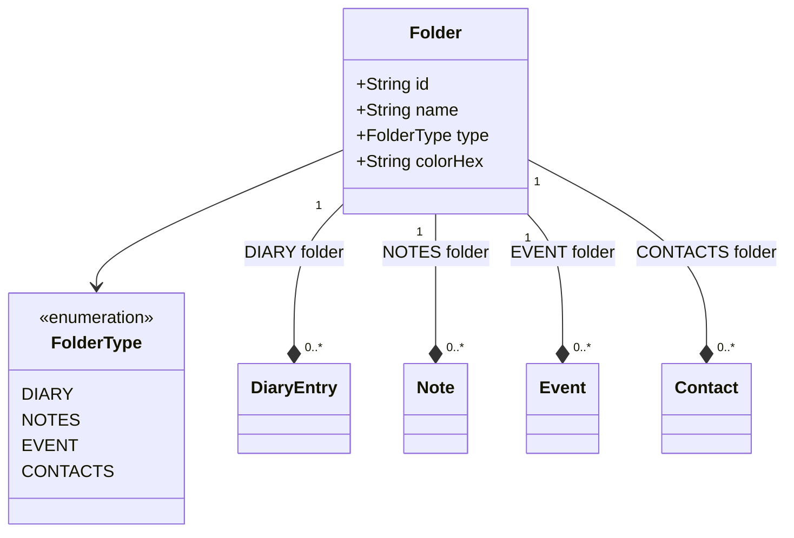

# MyDiary — Feature Roadmap & TODO

This document outlines the phased development roadmap for **MyDiary**, prioritizing foundational database and UI integration before expanding into specialized folder types.

---

## 📌 Core Domain Concept: Typed Folders

Every folder in MyDiary belongs to a single **`FolderType`**, serving as a dedicated container for items of that specific type:

| Folder Type | Purpose | Content Type | Examples |
| :--- | :--- | :--- | :--- |
| **`DIARY`** | Personal daily journals | `DiaryEntry` (date, mood, weather, content, bookmarks) | *"みつはのにっき"*, *"Main Diary"* |
| **`NOTES`** | Freeform lists, rules, memos | `Note` (title, markdown/text, pinned flag) | *"禁止事項"*, *"行きたいおみせメモ"* |
| **`EVENT`** | Scheduled plans and tasks | `CalendarEvent` & `Task` (time, location, recurrence) | *"Kamakura Trip"*, *"Part-time Shifts"* |
| **`CONTACTS`** | Dedicated contact phonebook | `Contact` (name, phone, note, emergency flag) | *"緊急時以外かけちゃダメ"* |

---

## 🚀 Phase 1: Core Foundation (Do This First)

> **Goal**: Replace mock repositories with a live Room SQLite database and connect `FolderListScreen` to real persistent storage.

- [ ] **1.1 Set up Room Local Storage (`data/local/`)**
  - [ ] Implement `AppDatabase.kt` with Room database builder.
  - [ ] Create `FolderEntity.kt` (`id`, `name`, `type`, `color_hex`, `sort_order`, `created_at`, `updated_at`).
  - [ ] Create `FolderDao.kt` (CRUD operations + `Flow<List<FolderEntity>>`).
  - [ ] Add Room TypeConverters for `FolderType` and `Instant` timestamps.
- [ ] **1.2 Real Repository Implementation**
  - [ ] Implement `FolderRepositoryImpl.kt` implementing `domain.folder.FolderRepository`.
  - [ ] Create entity-to-domain mappers (`FolderEntity.toDomain()`, `Folder.toEntity()`).
- [ ] **1.3 Connect `FolderListScreen` to Room**
  - [ ] Update `MainActivity.kt` and `FolderListViewModel` to inject/use `FolderRepositoryImpl`.
  - [ ] Seed initial default folders if the database is empty on first launch.
- [ ] **1.4 Folder Management UI**
  - [ ] Dialog/Sheet to create a new folder (select name, color, and `FolderType`).
  - [ ] Rename & Delete folder actions (with swipe-to-delete or context menu).

---

## 📖 Phase 2: Diary Folder (`DIARY`)

> **Goal**: Enable reading, writing, and browsing personal diary entries inside DIARY-type folders.

- [ ] **2.1 Diary Database Schema**
  - [X] Create `EntryEntity.kt` with `folder_id` foreign key (`id`, `folder_id`, `title`, `body`, `entry_date`, `mood_score`, `mood_label`, `weather_summary`, `temperature_high`, `temperature_low`, `is_favorite`, `created_at`, `updated_at`).
  - [ ] Create `EntryDao.kt` (query entries by `folder_id`, get single entry, insert, update, soft delete).
  - [ ] Create `TagEntity.kt` and `EntryTagCrossRef.kt` for many-to-many tag relationships.
- [ ] **2.2 Diary Repository**
  - [X] Define `DiaryRepository` interface in `domain/timeline/` (or `domain/diary/`).
  - [ ] Implement `DiaryRepositoryImpl` in `data/repository/`.
- [ ] **2.3 Diary Entry List Screen**
  - [ ] Create `DiaryListScreen` displaying entries in chronological order.
  - [ ] Connect existing `DiaryEntryCard` component to render feed summaries.
  - [ ] Tag filter chips at the top to filter entries by tags.
- [ ] **2.4 Diary Entry Detail & Editor**
  - [ ] Connect existing `DiaryEntryWindow` to view full entries.
  - [ ] Create/Edit Entry modal or screen:
    - Title and body text editing.
    - Mood picker.
    - Weather picker.
    - Date & time picker.
    - Bookmark / Favorite toggle.

---

## 📝 Phase 3: Notes Folder (`NOTES`)

> **Goal**: Lightweight memo system for rules, to-do lists, and quick ideas.

- [ ] **3.1 Note Entity & DAO**
  - [ ] Create `NoteEntity.kt` (`id`, `folder_id`, `title`, `content`, `is_pinned`, `sort_order`, `updated_at`).
  - [ ] Create `NoteDao.kt`.
- [ ] **3.2 Notes Screen & Editor**
  - [ ] Simple card/tile list view of notes inside a Notes folder.
  - [ ] Quick note composer dialog with Markdown or plain text support.
  - [ ] Pinning favorite notes to the top.

---

## 👤 Phase 4: Contacts Folder (`CONTACTS`)

> **Goal**: Store emergency contacts and important people.

- [ ] **4.1 Contact Entity & DAO**
  - [ ] Create `ContactEntity.kt` (`id`, `folder_id`, `name`, `phone_number`, `note`, `avatar_uri`, `is_emergency`, `created_at`).
  - [ ] Create `ContactDao.kt`.
- [ ] **4.2 Contacts Screen**
  - [ ] Contact list with phone call action button.
  - [ ] Highlighting emergency contacts with warning styling (*"緊急時以外かけちゃダメ"*).
  - [ ] Add/Edit contact form.

---

## 📅 Phase 5: Events & Tasks Folder (`EVENT`)

> **Goal**: Chronological calendar events and actionable reminders.

- [ ] **5.1 Event & Task Database**
  - [ ] Create `CalendarEventEntity.kt` (`id`, `folder_id`, `title`, `description`, `start_at`, `end_at`, `location`, `recurrence`).
  - [ ] Create `TaskEntity.kt` (`id`, `folder_id`, `title`, `due_date`, `is_completed`, `priority`).
  - [ ] Create `EventDao.kt` and `TaskDao.kt`.
- [ ] **5.2 Timeline / Calendar UI**
  - [ ] Timeline feed showing upcoming events and tasks.
  - [ ] Checkbox interaction to complete tasks directly from the feed.

---

## 🎨 Phase 6: Polish & Advanced Features

- [ ] **Full-Text Search (FTS)**: `entries_fts` virtual table for instant search across all entries and notes.
- [ ] **Photo Attachments**: `media_attachments` table with camera/gallery image picker.
- [ ] **Theme Customization**: BlueSky and custom color palettes persisted via DataStore / `app_settings`.
- [ ] **Backup & Export**: Export diary to JSON / Markdown files.
